# ⚡ Awesome Environment Variables &amp; Configuration Ecosystem

<p align="center">
  
</p>

<p align="center">
  <a href="https://github.com/ishandutta2007/Awesome-Awesome-Awesome"></a><a href="https://discord.gg/jc4xtF58Ve"></a>
  <a href="https://github.com/ishandutta2007/Awesome-Environment-Variables-Configuration/stargazers"></a>
  <a href="https://github.com/ishandutta2007/Awesome-Environment-Variables-Configuration/network/members"></a>
  <a href="https://github.com/ishandutta2007/Awesome-Environment-Variables-Configuration/issues"></a>
  <a href="https://github.com/ishandutta2007/Awesome-Environment-Variables-Configuration/blob/main/LICENSE"></a>
  <a href="https://github.com/ishandutta2007"></a>
</p>

---

## 🧭 Curated Directory for Secrets Management, Config Injection &amp; Parameter Stores

> **A comprehensive, battle-tested index of enterprise SaaS platforms and open-source GitHub projects for managing environment variables, encrypted secrets, dynamic credentials, and feature flags across Kubernetes, CI/CD, and local dev environments.**

This repository tracks notable **SaaS platforms** and **open-source projects** for **Environment Variables &amp; Configuration Management**. Modern microservice and cloud-native architectures mandate strict separation of code from configuration (12-Factor App methodology). These tools cover every tier of the modern config lifecycle—from lightweight `.env` file parsers and GitOps secret encryptors (SOPS, age, Sealed Secrets) to runtime injection engines (Dopbase, Doppler) and enterprise secret vaults (HashiCorp Vault, Infisical).

---

## 📑 Table of Contents

- [📊 Sector Overview &amp; Market Dynamics](#-sector-overview--market-dynamics)
- [☁️ SaaS &amp; Hosted Platforms](#-saas--hosted-platforms)
- [🔓 Open-Source GitHub Projects](#-open-source-github-projects)
  - [🏆 Primary Open-Source Solutions (Ranked by Stars)](#-primary-open-source-solutions-ranked-by-stars)
  - [🛠️ SDKs &amp; Specialized Integrations](#️-sdks--specialized-integrations)
- [💡 Architectural Recommendations &amp; Decision Guide](#-architectural-recommendations--decision-guide)
- [📈 Star History](#-star-history)
- [🤝 How to Contribute](#-how-to-contribute)
- [💖 Support &amp; Sponsorship](#-support--sponsorship)
- [⚖️ Disclaimer &amp; Security Notice](#️-disclaimer--security-notice)

---

## 📊 Sector Overview &amp; Market Dynamics

The global secrets and configuration management software market is estimated between **$2.5B and $5.1B** in 2026, expanding at an aggressive **~14–16% CAGR** driven by multi-cloud infrastructure, DevSecOps pipeline automation, and the explosion of non-human machine identities (outnumbering human developers by over 45:1).

The sector is **moderately fragmented**:
- **Mega-cap Cloud Providers** (Microsoft Azure App Configuration, AWS SSM Parameter Store) provide foundational, zero-friction parameter storage natively integrated into compute primitives.
- **Enterprise Stalwarts** (HashiCorp Vault / IBM) establish governance, HSM integrations, and dynamic credential leasing for regulated Fortune 500 fleets.
- **Modern DevSecOps Specialists** (Doppler, Infisical, LaunchDarkly) capture surging developer mindshare by pioneering zero-leak runtime injection (`run --`), automated multi-environment secret synchronization, and feature-flags-as-configuration workflows.

---

## ☁️ SaaS &amp; Hosted Platforms

*Below is a comparative breakdown of leading managed environment variable and secrets management platforms, sorted descending by company scale and valuation.*

| Product | Description | Valuation / Scale | Pricing (Starting) | Free Tier / Trial Limits |
|---------|-------------|-------------------|-------------------|--------------------------|
| **[Azure App Configuration](https://azure.microsoft.com/en-us/products/app-configuration/)** | 🌐 Centralized configuration store with feature flags, key-value pairs, and label-based environments. Integrates natively with .NET, Java, Spring, and Kubernetes. | Parent: Microsoft (~$3.1T Market Cap / ~$245B+ Revenue) | **$1.20/day** (~$36/mo) per store (Standard tier; includes 200,000 requests/day, then $0.06/10k requests) | **Free forever plan**: 1 store, 10 MB configuration storage, 1,000 requests/day (HTTP 429 after limit) |
| **[AWS Systems Manager Parameter Store](https://aws.amazon.com/systems-manager/)** | ☁️ Secure hierarchical storage for configuration data and secrets. Integrates natively with EC2, Lambda, ECS, EKS, and CloudFormation. | Parent: Amazon / AWS (~$2.1T Market Cap / ~$105B+ AWS Revenue) | **Standard: Free ($0)**; **Advanced: $0.05/parameter/month** (prorated hourly + $0.05 per 10,000 API interactions) | **Free forever plan**: Up to 10,000 standard parameters per account/region, 4 KB/parameter, default 40 TPS API throughput |
| **[HashiCorp Vault](https://www.hashicorp.com/)** | 🏛️ **The enterprise secret management standard.** Secure storage for arbitrary key/value pairs, **dynamic secrets** generated on-demand for AWS/SQL with automatic revocation, encryption-as-a-service, and audit logs. | Acquisition: IBM acquired HashiCorp for **$6.4B EV** (~$583M Revenue) | **HCP Vault Dedicated Development tier**: **~$0.62/cluster/hour** (~$450/month) | **Vault Community Edition**: Free forever (self-hosted); **HCP Vault Cloud**: $500 free trial credits for new HCP accounts (no permanent free managed cluster) |
| **[LaunchDarkly](https://launchdarkly.com/)** | 🚩 **The enterprise feature management standard.** Flag targeting, percentage rollouts, A/B testing, and **MCP server for AI agents** to safely toggle flags and manage targeting rules. | **$3.0B Valuation** (~$330M total funding, ~$60M+ ARR) | **$0 base / pay-as-you-go** on Foundation tier (~$10–$12 per service connection/month, unlimited seats) | **Free forever plan (Developer)**: Unlimited seats, 1 project, 3 environments, 1,000 client-side MAU, 5 service connections, 5,000 AI runs/mo |
| **[Infisical](https://infisical.com/)** | 🔐 **Open-source platform for secrets, certificates, and privileged access management.** Centralized secret sync across environments, PKI/certificate management, and AI agent credential proxying. | **$600M Valuation** (~$59M total funding raised) | **$23 per identity / month** ($20/mo billed annually on Pro plan; unlimited identities) | **Free forever plan**: Up to 5 total identities (human/machine), unlimited projects, 3 environments/project, 10 native secret syncs |
| **[Pulumi ESC](https://www.pulumi.com/esc/)** | ⚡ **Environments, Secrets, and Configuration** for Pulumi and external workflows. Injects env vars into GitHub Actions, supports OIDC short-lived tokens, and manages hierarchical environments. | **~$390M Valuation** (~$99M total funding, ~$20M ARR) | **$40/month base** (Essentials team tier, unlimited users, includes base credits for 500 managed resources) | **Free forever plan**: 1 user, up to 25 secrets, unlimited plaintext configurations, 10,000 ReadOpen API calls/month, unlimited environments |
| **[Doppler](https://www.doppler.com/)** | 🚀 **The source-of-truth secret manager for modern dev workflows.** Centralizes environment variables across projects/configs (dev/ci/prod) with CLI injection via `doppler run --`. **Never writes secrets to disk**. | **~$45M+ Valuation** (~$28.9M total funding raised) | **$21 per user / month** ($12–$21/mo depending on annual billing on Team plan) | **Free forever plan (Developer)**: Up to 3 users, Doppler CLI runtime injection, service tokens, 5 config syncs, 3-day activity logs |
| **[ConfigCat](https://configcat.com/)** | 🎛️ Feature flag service with **generous free tier for up to 1,000 users**. SDKs for all major languages and frameworks (Angular, React, .NET, Next.js, etc.). | Bootstrapped / $0 external funding (~$300K+ ARR) | **$110/month** (Pro plan; unlimited team members, up to 100 feature flags, 25M config JSON downloads/mo) | **Free forever plan**: Unlimited team members, 10 feature flags, 2 products, 2 environments, ~5M config JSON downloads/month |

---

## 🔓 Open-Source GitHub Projects

Open-source tooling is essential for engineering teams seeking strict data sovereignty, self-hosted air-gapped deployments, GitOps integration, or freedom from recurring per-seat SaaS costs.

### 🏆 Primary Open-Source Solutions (Ranked by Stars)

*Repositories are sorted in descending order based on their GitHub stargazer count. Each star badge links directly to that repository's stargazers page.*

| Project | Star Badge | Description |
|---------|------------|-------------|
| **[HashiCorp Vault](https://github.com/hashicorp/vault)** | [](https://github.com/hashicorp/vault/stargazers) | 🛡️ **The enterprise foundation of secret management.** Hardware security module (HSM) integration, **dynamic on-demand secrets** with automated lease revocation, encryption-as-a-service (transit engine), and tamper-evident audit logging. |
| **[Infisical](https://github.com/Infisical/infisical)** | [](https://github.com/Infisical/infisical/stargazers) | 🔑 **Comprehensive open-source secrets management platform.** End-to-end encrypted secret sync across cloud providers, Kubernetes Operator, native CLI, PKI/certificate manager, and AI agent credential proxying. |
| **[age](https://github.com/FiloSottile/age)** | [](https://github.com/FiloSottile/age/stargazers) | 🔒 **Simple, modern, and secure file encryption tool.** Features small explicit keys, no config options, and UNIX-style composability. Frequently utilized as the modern cryptographic backend for GitOps secret workflows. |
| **[SOPS](https://github.com/getsops/sops)** | [](https://github.com/getsops/sops/stargazers) | 📄 **Secrets OPerationS (SOPS) by Mozilla/Community.** Editor of encrypted files supporting YAML, JSON, ENV, INI, and BINARY formats. Seamlessly encrypts only values (preserving keys for diffs) using AWS KMS, GCP KMS, Azure Key Vault, age, and PGP. |
| **[dotenv](https://github.com/motdotla/dotenv)** | [](https://github.com/motdotla/dotenv/stargazers) | 📦 **The zero-dependency `.env` file parser for Node.js.** Loads environment variables from `.env` into `process.env`. Companion **`dotenvx`** enables multi-environment encrypted `.env` files committed securely into version control. |
| **[Bitnami Sealed Secrets](https://github.com/bitnami-labs/sealed-secrets)** | [](https://github.com/bitnami-labs/sealed-secrets/stargazers) | ☸️ **Kubernetes-native "one-way" encrypted secrets.** Encrypts your Secret into a SealedSecret custom resource safe to store in public Git. Only the controller running inside your cluster can decrypt it into a native Kubernetes Secret. |
| **[External Secrets Operator](https://github.com/external-secrets/external-secrets)** | [](https://github.com/external-secrets/external-secrets/stargazers) | 🔄 **Kubernetes operator integrating external secret management systems.** Synchronizes secrets from AWS Secrets Manager, HashiCorp Vault, Azure Key Vault, Google Secret Manager, and Doppler directly into Kubernetes Secrets. |
| **[CyberArk Conjur OSS](https://github.com/cyberark/conjur)** | [](https://github.com/cyberark/conjur/stargazers) | 🏛️ **Open-source security service for machine identity and secrets.** Enforces role-based access control (RBAC), machine authentication, and real-time audit trails across containers, CI/CD pipelines, and microservices. |
| **[Dopbase](https://github.com/dopbase/dopbase)** | [](https://github.com/dopbase/dopbase/stargazers) | 🚀 **Self-hosted alternative to Doppler for runtime secret injection.** Single binary server that injects secrets directly into process memory (`dopbase run`) with **zero secrets written to disk**, bearer tokens for CI/AI agents, and tamper-evident audit logging. |
| **[fastenv](https://github.com/br3ndonland/fastenv)** | [](https://github.com/br3ndonland/fastenv/stargazers) | ⚡ **High-performance async Python `.env` loader.** Built on AnyIO with `find_dotenv` recursive search, structured type parsing, and optimized support for asynchronous Python frameworks (FastAPI, Starlette). |

### 🛠️ SDKs &amp; Specialized Integrations

| Project | Star Badge | Description |
|---------|------------|-------------|
| **[Pulumi ESC (SDK)](https://github.com/pulumi/esc)** | [](https://github.com/pulumi/esc/stargazers) | 🧩 **Open-source SDK for Pulumi ESC environments.** Programmatically list, open, validate, and read hierarchical environments and secrets via .NET (`Pulumi.Esc.Sdk`), Python, and Go. |
| **[ConfigCat (Common JS / SDKs)](https://github.com/configcat/common-js)** | [](https://github.com/configcat/common-js/stargazers) | 🎯 **Open-source SDK implementations for ConfigCat feature flags.** Demonstrates caching, offline mode, and feature targeting evaluation across JavaScript, React, Angular, and Node.js. |

---

## 💡 Architectural Recommendations &amp; Decision Guide

```
+-----------------------------------------------------------------------------------+
|                        CHOOSE YOUR SECRETS & CONFIG STRATEGY                      |
+-----------------------------------------------------------------------------------+
                                          |
        +---------------------------------+---------------------------------+
        |                                                                   |
 [Local / Simple Apps]                                              [Cloud / Production Fleet]
        |                                                                   |
        v                                                                   v
  Need simple dev config?                                      What is your primary runtime?
    ├── dotenv / dotenvx (Node)                                             |
    └── fastenv (Python)                                                    |
                                            +-------------------------------+-------------------------------+
                                            |                               |                               |
                                      [Kubernetes / GitOps]          [Runtime Injection]           [Centralized Vault]
                                            |                               |                               |
                                            ├── SOPS + age                  ├── Dopbase (Self-hosted)       ├── HashiCorp Vault
                                            ├── Sealed Secrets              └── Doppler (Hosted SaaS)       ├── Infisical
                                            └── External Secrets Operator                                   └── AWS / Azure Parameter Store
```

- **For Zero-Disk Runtime Injection**: Choose **[Dopbase](https://github.com/dopbase/dopbase)** (self-hosted single binary) or **[Doppler](https://www.doppler.com/)** (hosted SaaS) to inject environment variables into memory at runtime (`run --`) without ever saving unencrypted secrets to disk.
- **For GitOps &amp; Infrastructure as Code**: Choose **[SOPS](https://github.com/getsops/sops)** with **[age](https://github.com/FiloSottile/age)** to encrypt secret values directly in Git, or use **[Sealed Secrets](https://github.com/bitnami-labs/sealed-secrets)** in Kubernetes clusters.
- **For Enterprise Dynamic Credentials &amp; PKI**: Deploy **[HashiCorp Vault](https://github.com/hashicorp/vault)** or **[Infisical](https://github.com/Infisical/infisical)** for dynamic database user provisioning, automated credential rotation, and certificate authority lifecycle management.

---

## 📈 Star History

[](https://www.star-history.com/#ishandutta2007/Awesome-Environment-Variables-Configuration&type=date&legend=top-left)

---

## 🤝 How to Contribute

Contributions are always welcome! 🚀

1. 🍴 **Fork the repository**
2. 🌿 **Create a feature branch** (`git checkout -b feature/amazing-tool`)
3. 📝 **Add your entry** in alphabetical or star-ranked order with accurate, factual pricing and documentation
4. 💾 **Commit your changes** (`git commit -m 'Add AmazingTool to open-source section'`)
5. 📤 **Push to the branch** (`git push origin feature/amazing-tool`)
6. 🔀 **Open a Pull Request**

---

## 💖 Support &amp; Sponsorship

If this curated repository helped you secure your infrastructure or streamline your configuration workflows, please consider supporting the project:

- ⭐ **Star this repository** on GitHub
- 🍴 **Fork and share** it with your fellow DevOps engineers and team
- ☕ **Buy me a coffee / Sponsor**: Support ongoing maintenance on the [GitHub Sponsor Dashboard](https://github.com/sponsors/ishandutta2007)

---

## ⚖️ Disclaimer &amp; Security Notice

- This is an independently curated open-source community resource — not an official endorsement.
- **Security Best Practice**: Secret stores and parameter managers hold credentials to your entire infrastructure. Enforce multi-factor authentication (MFA), strict least-privilege role separation (RBAC), IP whitelisting, and automated audit logging. **Never commit raw `.env` files or hardcoded credentials into version control.**

---

<p align="center">
  <b>Built with ❤️ for developers, platform engineers, and security teams worldwide.</b><br/>
  Let's make secrets and environment variables secure, open, and injection-first. 🔒✨
</p>
